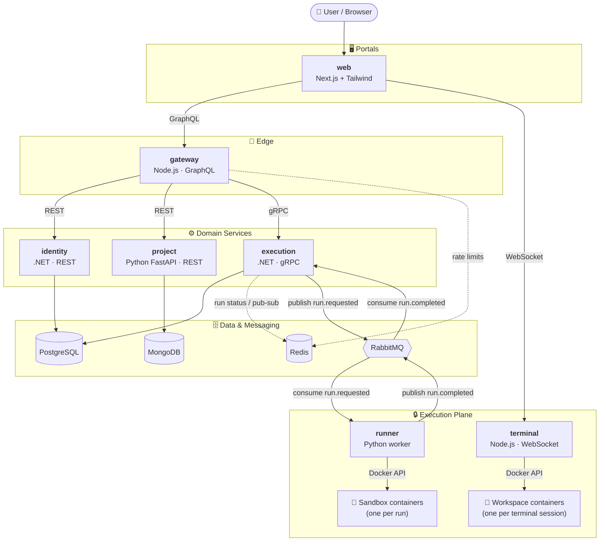
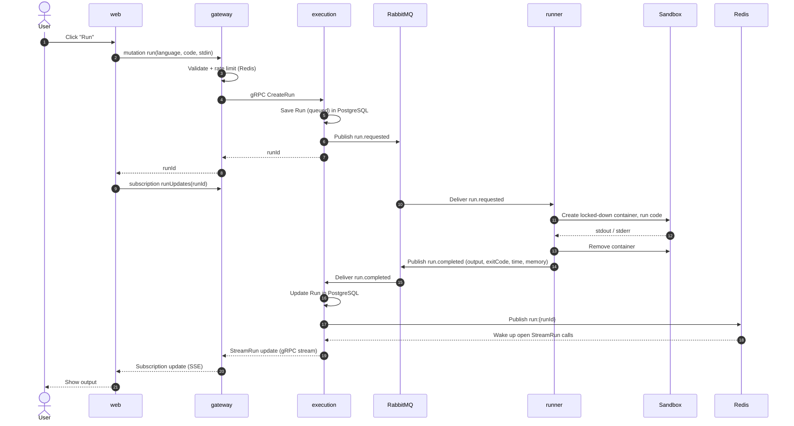
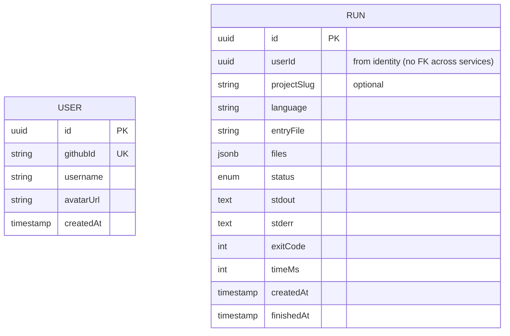
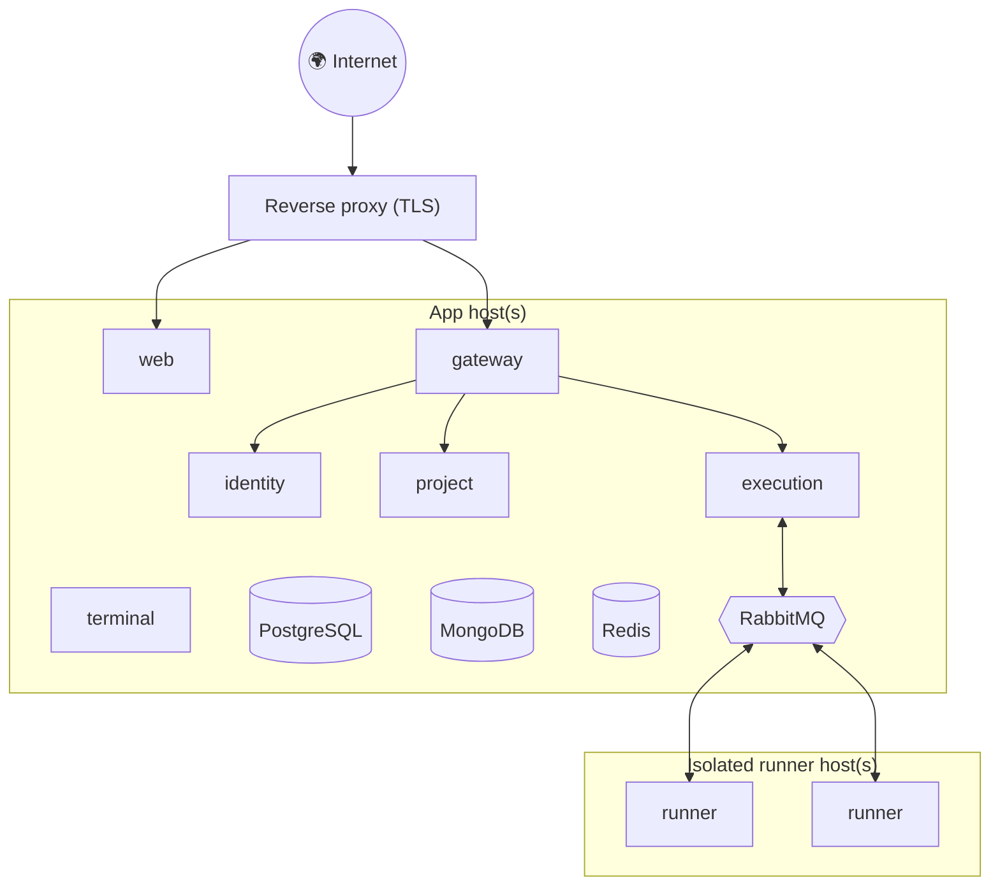
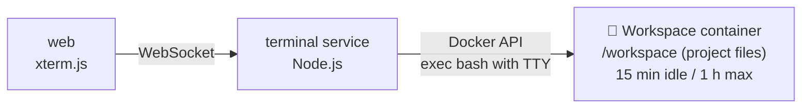

# Bytebox — Architecture Overview

> An online code playground: build multi-file projects in the browser, run any file in an isolated sandbox, use a simple terminal, and share projects via link.

**Status:** Draft (v0.3) · **Style:** Microservices, one folder + one Dockerfile per domain, everything orchestrated with `docker-compose.yml`

---

## 1. Goals & Non-Goals

**Goals**
- Run untrusted user code **safely** with strict CPU, memory, time, process and network limits.
- Feel fast: a typical run finishes in **< 2s** end to end.
- Multi-file projects: files and folders, run the currently open file.
- A simple terminal per user session for basic shell commands.
- Share projects with short, stable URLs (`/p/a8Kx2p`).
- Each domain is an independent service that can be built, deployed and scaled on its own.

**Non-goals (for v1)**
- Full IDE features (debugger, extensions, package installs).
- Servers or background processes that outlive a run or terminal session.
- Network access from user code.

---

## 2. Services at a Glance

| Folder | Domain | Tech | Exposes | Owns data in | Host port |
|---|---|---|---|---|---|
| `portals/web` | Web portal (UI) | Next.js, TypeScript, Tailwind CSS | Web pages | – | 3000 |
| `services/gateway` | API gateway / BFF | Node.js, TypeScript, GraphQL Yoga | **GraphQL** | Redis (rate limits) | 4000 |
| `services/identity` | Users & login (GitHub, Google) | .NET (ASP.NET Core) | **REST** (redirects + session cookie) | PostgreSQL `identity` | 5001 |
| `services/execution` | Run lifecycle | .NET (ASP.NET Core) | **gRPC** (+ REST health) | PostgreSQL `execution`, Redis | 5002 |
| `services/project` | Projects (files & folders) & sharing | Python, FastAPI | **REST** | MongoDB | 5003 |
| `services/runner` | Sandbox worker (one-off runs) | Python | **RabbitMQ** consumer | – | – |
| `services/terminal` | Terminal sessions | Node.js, TypeScript | **WebSocket** | – (sessions in memory) | 4100 |

**Infrastructure**

| Component | Purpose | Host port |
|---|---|---|
| PostgreSQL 16 | Relational data (users, runs) — one database per service | 5432 |
| MongoDB 8 | Document data (projects) | 27017 |
| Redis 7 | Cache, rate limits, run status, pub/sub | 6380 |
| RabbitMQ 4 | Event bus between execution and runner | 5673 (UI: 15673) |

> Host ports for Redis and RabbitMQ are shifted (6380, 5673) so they don't clash with local instances. Inside the Docker network every service uses the default ports.

---

## 3. High-Level Architecture



### Communication styles

| From → To | Style | Why |
|---|---|---|
| web → gateway | **GraphQL** (HTTP, subscriptions over Server-Sent Events) | One flexible API for the UI, live run updates via subscriptions |
| gateway → identity, project | **REST** | Simple CRUD resources |
| web → terminal | **WebSocket** | Interactive shell: keystrokes in, terminal output out |
| gateway → execution | **gRPC** | Typed contract, fast internal calls, streaming output |
| execution ↔ runner | **RabbitMQ events** | Decouples API from slow, risky execution; absorbs bursts; scale runners independently |
| execution → gateway (live updates) | **gRPC server streaming** (`StreamRun`) | Gateway turns the stream into a GraphQL subscription |
| inside execution | **Redis pub/sub** (`run:{id}`) | Wakes up open `StreamRun` calls when a result is saved |

---

## 4. Code Execution Flow



**Run states:** `queued → running → completed | timed_out | memory_exceeded | failed`

**Live output:** while a program runs, the runner publishes its output so far to `run.output` (at most every 250 ms, only when it changed). Execution keeps it in Redis (`run:{id}:live`, 10 min) and wakes up `StreamRun`, which sends status `running` with the partial output; the web portal shows it line by line. The database only stores the final result.

- `completed`: the program finished (any exit code, including compile errors)
- `timed_out`: killed after the time limit
- `memory_exceeded`: killed for using too much memory
- `failed`: Bytebox could not run it (unknown language, code too large, internal error)

### Events (RabbitMQ)

| Event | Producer | Consumer | Payload |
|---|---|---|---|
| `run.requested` | execution | runner | `runId, language, code, stdin, limits` |
| `run.started` | runner | execution | `runId, startedAt` |
| `run.output` | runner | execution | `runId, stdout, stderr` (output so far, while running) |
| `run.completed` | runner | execution | `runId, status, exitCode, stdout, stderr, truncated, timeMs` |

---

### Supported languages

| Language | Extension | Sandbox image | Time / memory |
|---|---|---|---|
| Python | `.py` | `python:3.13-slim` | 5 s / 128 MB |
| JavaScript | `.js` | `node:24-alpine` | 5 s / 128 MB |
| TypeScript | `.ts` | `node:24-alpine` (types stripped by Node 24) | 5 s / 128 MB |
| Java | `.java` | `eclipse-temurin:25-jdk-alpine` (runs from source; other classes in the project are found automatically) | 10 s / 256 MB |
| C++ | `.cpp` | `bytebox/sandbox-cpp` (Alpine + g++) | 10 s / 256 MB |
| Go | `.go` | `bytebox/sandbox-go` (Go 1.25 with the standard library pre-compiled into a read-only build cache; other `.go` files in the entry's folder are built with it) | 10 s / 256 MB |
| Rust | `.rs` | `rust:1-slim` (`rustc -O`; other files are found through `mod name;`) | 10 s / 256 MB |
| HTML/CSS/JS | `.html` | — (live preview in the browser) | — |

> A cold Go build compiles the standard library first (~15 s on half a CPU). `bytebox/sandbox-go` runs `go build std` at image build time, so a run only compiles the user's code (< 1 s).

## 5. Sandbox Security Model

Running untrusted code is the core risk. Every run gets a **fresh, single-use container**:

| Threat | Mitigation |
|---|---|
| Infinite loop | Wall-clock timeout + container kill |
| Memory bomb | `--memory`, no swap |
| Fork bomb | `--pids-limit` |
| CPU starvation | `--cpus`, bounded runner concurrency |
| Network abuse | `--network=none` |
| Tampering with host | Read-only rootfs, tmpfs `/tmp`, non-root user, `--cap-drop=ALL` |
| Container escape | `no-new-privileges`, seccomp; later gVisor or Firecracker |
| Output flooding | Byte cap + truncation |
| API abuse | Rate limits in gateway (Redis), max code size |

> ⚠️ The runner talks to the Docker socket, which is effectively **root on the host**. In production, runners live on separate, isolated machines.

---

## 6. Data Ownership

Each service owns its data. No service reads another service's database.



- **identity → PostgreSQL `identity`:** `users`
- **execution → PostgreSQL `execution`:** `runs`
- **project → MongoDB `projects` collection:**

```json
{
  "_id": "a8Kx2pQ1",
  "ownerId": "uuid | null",
  "forkedFrom": "slug | null",
  "title": "My project",
  "files": [
    { "path": "main.py", "content": "from utils.greet import hello\nhello()" },
    { "path": "utils/greet.py", "content": "def hello():\n    print('hi')" }
  ],
  "stdin": "",
  "editTokenHash": "sha256 of the secret edit token",
  "createdAt": "date",
  "updatedAt": "date"
}
```

Folders are implied by file paths (`utils/greet.py`); empty folders are listed in `folders`. The 8-character share slug is the document `_id`.

---

## 7. Repository Layout

```
bytebox/
├── docker-compose.yml        # Runs infrastructure + all services + portals
├── .env.example
├── infra/
│   └── postgres/init.sql     # Creates one database per service
├── proto/                    # Shared gRPC contracts (execution.proto)
├── portals/
│   └── web/                  # Next.js + Tailwind      → Dockerfile
└── services/
    ├── gateway/              # Node.js GraphQL gateway → Dockerfile
    ├── identity/             # .NET REST service       → Dockerfile
    ├── execution/            # .NET gRPC service       → Dockerfile
    ├── project/              # Python FastAPI service  → Dockerfile
    ├── terminal/             # Node.js WebSocket service → Dockerfile
    └── runner/               # Python sandbox worker   → Dockerfile
```

### Running locally

```bash
docker compose up -d --build     # build and start everything
docker compose ps                # see what's running
docker compose logs -f runner    # follow one service's logs
docker compose down              # stop everything
```

| URL | What |
|---|---|
| http://localhost:3000 | Web portal |
| http://localhost:4000/graphql | GraphQL API (GraphiQL in browser) |
| http://localhost:5001/health | identity (login at `/auth/github/login`) |
| http://localhost:5002/health | execution (REST) |
| localhost:50051 | execution (gRPC) |
| http://localhost:5003/docs | project (Swagger UI) |
| ws://localhost:4100 | terminal (WebSocket) |
| http://localhost:15673 | RabbitMQ management UI |

---

## 8. Deployment (later)



- Same images as local; compose for a single VM first, Kubernetes later if needed.
- Runners on **separate machines** because they control Docker.
- Scale by adding runner replicas (`docker compose up --scale runner=3`).

---

## 9. Development Plan (Step by Step)

Each step ends with something runnable via `docker compose up`. Every step is a `feature/*` branch + PR.

### Step 0 — Project Skeleton
- [x] Folder per domain (`portals/*`, `services/*`)
- [x] Dockerfile for every service
- [x] `docker-compose.yml` with PostgreSQL, MongoDB, Redis, RabbitMQ + all services
- [x] `/health` endpoint in every HTTP service
- [x] Runner connects to RabbitMQ and listens on `run.requested`
- [x] Web portal landing page (Next.js + Tailwind)
- [x] `.gitignore`, `.editorconfig`, `.env.example`
- [x] Verify the .NET services build and answer `/health`

**✅ Done when:** `docker compose up -d --build` starts everything and all health checks pass.

### Step 1 — Runner: Sandboxed Execution
- [x] Language configs (Python, JavaScript, C++ with a small Alpine + g++ image)
- [x] Run code in a fresh Docker container (Docker socket mounted into runner)
- [x] Limits: timeout, memory, CPU, PIDs, output cap (64 KB), code size (64 KB)
- [x] Isolation: no network, read-only FS, non-root, drop capabilities, no-new-privileges
- [x] Always remove containers; label them `bytebox=sandbox`
- [x] Consume `run.requested`, publish `run.completed` with output, exit code and time
- [x] Tests: hello world per language, compile/runtime errors, infinite loop, fork bomb, memory bomb, network call, read-only FS, non-root, huge output, output flood
- [x] `send_job.py` script to try the runner by hand
- [ ] Memory usage metric per run (later)

**Try it:**

```bash
cd services/runner
python3 -m venv .venv && .venv/bin/pip install -r requirements-dev.txt
.venv/bin/python -m pytest                                   # sandbox tests
.venv/bin/python send_job.py python examples/hello.py Vedat  # full round trip via RabbitMQ
```

### Step 2 — Execution Service
- [x] `proto/execution.proto` (`CreateRun`, `GetRun`, `StreamRun`)
- [x] gRPC server in .NET on port 8081 (HTTP/2), `/health` on 8080, gRPC reflection enabled
- [x] `runs` table in PostgreSQL (EF Core, created on startup; switch to migrations when the schema changes)
- [x] Validate language and code size, publish `run.requested`
- [x] Consume `run.completed`, save the result, publish the update on Redis channel `run:{runId}`
- [x] `StreamRun` sends the current state, then updates until the run is finished

**Try it** (uses the `grpcurl` Docker image, nothing to install):

```bash
# Create a run
docker run --rm --network bytebox_default fullstorydev/grpcurl -plaintext \
  -d '{"language":"python","code":"print(input()[::-1])","stdin":"bytebox"}' \
  execution:8081 bytebox.execution.v1.ExecutionService/CreateRun

# Get the result (use the run_id from above)
docker run --rm --network bytebox_default fullstorydev/grpcurl -plaintext \
  -d '{"run_id":"<RUN_ID>"}' \
  execution:8081 bytebox.execution.v1.ExecutionService/GetRun
```

### Step 3 — Gateway (GraphQL)
- [x] Schema: `languages`, `run(id)` query, `createRun` mutation, `RunStatus` enum
- [x] gRPC client to execution (proto loaded at runtime from `proto/`)
- [x] `runUpdates(id)` subscription fed by execution's `StreamRun` (Server-Sent Events)
- [x] Input validation: supported language, max code size (64 KB)
- [x] Rate limiting with Redis: 20 runs per minute per IP (`RATE_LIMIT_RUNS_PER_MINUTE`)
- [x] Error codes for the UI: `BAD_USER_INPUT`, `NOT_FOUND`, `RATE_LIMITED`, `SERVICE_UNAVAILABLE`

**Try it:** open http://localhost:4000/graphql (GraphiQL) and run:

```graphql
mutation {
  createRun(input: { language: "python", code: "print(input().upper())", stdin: "hi" }) {
    id
    status
  }
}

subscription {
  runUpdates(id: "<RUN_ID>") { status stdout stderr exitCode timeMs }
}
```

### Step 4 — Web Portal: Editor & Run
- [x] Small GraphQL client: `fetch` for queries/mutations, `EventSource` for subscriptions (no library needed)
- [x] Monaco editor + language picker (loaded from `languages`) + starter template per language
- [x] Stdin panel, Run button, `⌘/Ctrl + Enter`
- [x] Output panel: stdout, stderr (red), exit code, time, status badge, truncation note
- [x] Live status via `runUpdates` subscription
- [x] Friendly errors: rate limited, API unreachable, invalid input
- [x] Autosave language, code (per language) and stdin in `localStorage`
- [x] Responsive: editor and output side by side on desktop, stacked on mobile

**Live preview:** projects with HTML files get **Output | Preview** tabs. The preview inlines the project's linked CSS/JS into one document and shows it in an iframe sandboxed with `allow-scripts` only (no same-origin access to Bytebox), updating as you type; a small console shows `console.log` output and errors. Runs entirely in the browser, so guests can use it.

**Themes:** Dark, Synthwave, Blue, Purple and Light, picked from the header (remembered per browser). Components use color tokens (`bg-panel`, `text-muted`, `bg-accent`, …) defined in `app/globals.css`; each theme sets the same CSS variables, and the editor (Monaco) and terminal (xterm) take their colors from them too.

> The browser calls the gateway directly at `NEXT_PUBLIC_GATEWAY_URL` (default `http://localhost:4000/graphql`). It is set as a Docker build argument because Next.js inlines it at build time.

### Step 5 — Multi-File Projects (files & folders)
- [x] **Web:** file explorer on the left — create, rename, delete files and folders; open files in tabs
- [x] **Web:** Run executes the **currently open file**; language detected from the extension (`.py`, `.js`, `.cpp`)
- [x] **Gateway + execution:** `createRun` takes `files: [{ path, content }]` + `entryFile` instead of a single `code` string (`execution.proto` updated)
- [x] **Runner:** receives the project as a tar archive on stdin, extracts it into `/tmp/project`, runs the entry file (C++: compiles the entry file plus every other `.cpp` file without `main()`)
- [x] Limits: max 50 files, max 256 KB total, safe paths only (no `..`, no absolute paths) — checked in execution and again in the runner
- [x] Execution service switched to **EF Core migrations** (`Migrations/`, applied on startup)
- [x] Autosave the whole workspace (files, folders, tabs, stdin) in `localStorage`
- [x] Tests: imports across files and folders in each language, reading project files, path traversal, limits, missing entry file

### Step 6 — Project Service & Sharing
- [x] Rename `services/snippet` → `services/project`
- [x] MongoDB `projects` collection; the 8-character share slug is the `_id` (unique)
- [x] REST: create (or fork with `forkedFrom`), get by slug, update, delete
- [x] **Edit tokens** (until login exists): creating a project returns a secret token, only its SHA-256 hash is stored; update and delete need `X-Edit-Token`
- [x] Same project rules as runs: 50 files, 256 KB, safe paths, unique paths
- [x] Gateway: `project(slug)` query, `createProject` and `updateProject` mutations
- [x] Web: **Share** (local workspace → `/p/[slug]`, link copied), **Save** for owners, **Fork** for visitors, **Copy link**, editable title, not-found page, warning before leaving with unsaved changes
- [x] Tests: create/get, update and delete need the token, fork gets its own token, invalid projects rejected

> The browser that creates a project keeps its edit token in `localStorage`. Anyone else with the link can view, run and fork it. Step 8 (login) will let owners edit from any device.

### Step 7 — Terminal Sessions
- [x] **Workspace image** (`bytebox/sandbox-workspace`): Alpine with bash, Python, Node.js, g++, coreutils, nano, less
- [x] **New `services/terminal`** (Node.js + `ws` + Docker API): one long-lived workspace container per session; the shell runs as a `docker exec` with a TTY
- [x] Browser ↔ terminal over **WebSocket** (JSON messages: `init`, `input`, `resize`, `sync`, `delete`, `pull` → `ready`, `output`, `files`, `error`, `exit`)
- [x] **Web:** terminal panel with **xterm.js** under the editor, `>_ Terminal` button, Restart and Close
- [x] **Web:** `? Commands` button opens a cheat sheet of terminal commands with examples
- [x] **Live two-way file sync:**
  - Terminal → file tree: the workspace is rescanned 400 ms after the shell goes quiet and every 5 s; when anything changed, the tree adds, updates, moves and deletes files and folders to match (binaries and files > 64 KB skipped)
  - Editor → terminal: new, renamed and deleted files/folders are sent right away; typing inside a file is sent after 800 ms
  - Edits not yet sent win over the terminal's copy; changes are numbered (`seq`) so scans taken before the latest editor change are ignored, and the service handles messages in order
- [x] Same sandbox rules as runs: no network, `nobody` user, read-only root FS, writable `/workspace` and `/tmp` (tmpfs), no capabilities, 256 MB, half a CPU, 64 processes
- [x] Session limits: **1 session per user** (a new one replaces the old one), closed after **15 min idle** or **1 hour** (was per IP before Step 8)
- [x] Only the web portal's origin may connect (`ALLOWED_ORIGINS`), other sites get 403
- [x] Cleanup: containers removed when a session ends, on service start, and by a sweep every minute
- [x] Tests (10): run project files, non-root + no network + read-only, sync, pull (skips binaries), automatic change updates (create/move/delete), deletes and new folders from the editor, replace old session, `exit` ends session, invalid paths, foreign origin rejected



### Step 8 — Identity Service & Auth
- [x] **GitHub login** (OAuth App, see `.env.example`): `/auth/github/login` → GitHub → `/auth/github/callback`, with a random `state` cookie against forged logins
- [x] **Google login** (OAuth client, see `.env.example`): same flow at `/auth/google/login` → Google → `/auth/google/callback` (OpenID Connect `userinfo`); GitHub and Google share one `IOAuthProvider` flow
- [x] `users` table in PostgreSQL (EF Core migrations); the first login creates the account; a GitHub and a Google account are separate Bytebox accounts (no linking by email)
- [x] **Session:** signed JWT (7 days) in an httpOnly cookie `bytebox_session`; the gateway and terminal service verify it with the shared `JWT_SECRET`
- [x] `/auth/logout`; redirects only to pages of the web portal (no open redirects)
- [x] Dev-only login `/auth/dev/login?login=<name>` behind `DEV_LOGIN_ENABLED` (off by default)
- [x] **Login required to run or change anything** (enforced in the backend, not only the UI):
  - gateway: `createRun`, `createProject`, `updateProject` → `UNAUTHENTICATED` when signed out
  - project service: create needs a user, update/delete only by the owner (edit tokens removed)
  - terminal service: WebSocket handshake needs a valid session (401), one session **per user**
  - viewing shared projects stays public
- [x] Gateway: `me`, `myProjects`, `Project.ownedByMe`; runs stored with the user id; 60 runs/minute per user
- [x] **Web:** profile section (avatar, name, My projects, Sign out) or **Log in**; `/login` page (Continue with GitHub, error messages); **"Login or sign up before making changes"** modal for guests on run, edit, terminal, new/rename/delete, stdin, share, save, fork; read-only editor for guests; **My projects** page at `/projects`
- [x] **Create workspace** (profile menu and My projects): pick a **template** (Blank JavaScript `init.js` "hello world", Python basics, Python data, Node.js app, C++ project, Algorithms), give it a name, and it opens ready to run
- [x] **Server projects (Express, Spring Boot, ASP.NET Core):** **▶ Start server** runs the project on the new **devserver** service (Node, dockerode, port 4300) and shows it in a 🖥 Server tab with a preview (GET address bar, open in new tab) and the live server log. Each server gets a container from a framework image with packages pre-installed (`bytebox/server-node` with express/cors/body-parser/uuid, `bytebox/server-spring` with the Spring Boot web libraries — compiled with `javac -parameters`, no Maven at run time — and `bytebox/server-dotnet`) on its own internal Docker network (no internet, no other services, no other servers), as nobody with a read-only root, memory/CPU/pid limits and a 30-minute limit; it stops when you stop it or leave the page, one server per user. The preview proxy (`/preview/<id>/…`, absolute paths routed by Referer) strips the Bytebox session cookie both ways. Templates: Express API, Spring Boot API, ASP.NET Core API
- [x] **Live collaboration:** the owner shares an invite link (👥 Collaborators tab: *Create invite link*, *New link*, *Turn off*); anyone signed in who opens it becomes a collaborator who can edit and save (private projects included). The owner and collaborators edit together in real time: a new **collab service** (Node, `ws`, Yjs + `y-protocols`, port 4200) keeps one shared document per project (files as `Y.Text`, folders, title, stdin, args), checks the session cookie and `canEdit` with the project service, and saves the document as the owner 2 s after the last change. In the editor everyone else's cursor and selection show in their own color with their name; the 👥 Collaborators tab lists who is online and in which file, the members (owner removes, collaborators leave) and the invite link; the header shows the online avatars and **● Live**. Project service: `collaborators`, `invite_token`, `POST /projects/{slug}/invite`, `DELETE /projects/{slug}/invite`, `POST /projects/{slug}/join`, `DELETE /projects/{slug}/collaborators/{id}`
- [x] **Landing page** at `/` (server-rendered): what Bytebox is, a hero editor that types, runs and shows output in Python/JavaScript/Rust, a scrolling language list, 12 feature cards that fade in on scroll, an animated "what happens when you press Run" service pipeline, live numbers from `stats`, getting-started steps and calls to action; animations are CSS/IntersectionObserver and switch off with `prefers-reduced-motion`. The local workspace moved to **`/playground`**
- [x] **Command-line arguments:** an *Arguments* field above stdin (`--name "Ada Lovelace" 3`; quotes keep spaces together), saved with the project and its versions (`args`); sent as a list (`CreateRunRequest.args`, at most 20 × 200 chars), stored in `runs.Args` (`text[]`, migration `AddRunArgs`), passed through the `run.requested` message, and the runner adds them to the run command with `shlex.quote`, so they never reach the shell as code
- [x] **Comments:** 💬 on a project opens its comments (oldest first, author and time); signed-in users who can see the project write one (1–1000 characters, ⌘/Ctrl + Enter), authors and the project owner can delete; `comments` collection, `GET/POST /projects/{slug}/comments`, `DELETE /projects/{slug}/comments/{id}` → gateway `Project.comments`, `commentCount`, `addComment`, `deleteComment` (same rate limit as saves)
- [x] **Forks:** the Fork button shows how many forks a project has; clicking the count lists the public forks (unlisted/private forks are only counted); a fork shows "⑂ forked from <title>" linking to the original, unless it was deleted or made private (`forkCount`, `forkedFromTitle`, `Project.forks` → `GET /projects/{slug}/forks`)
- [x] **Error hints:** a 💡 tip under the output for common problems: input asked but stdin empty (EOFError, NoSuchElementException), packages that can't be installed (no internet), infinite recursion, Python indentation, Java public class file name, Go unused variables, network calls, time limit and memory limit (`lib/hints.ts`)
- [x] **Clickable error locations:** file references in the output (`File "/tmp/project/lib/calc.py", line 3`, `main.cpp:2:11`, `./main.go:3:3`, `--> main.rs:2:18`, `(Main.java:4)`, Node stack frames) become links that open the file at that line and column; only paths of files in the project count (`lib/errorLocations.ts`); after a failed run those lines also get **red squiggles** in the editor with the error message (from the same line for compilers, otherwise the `…Error: …` summary), cleared on the next run
- [x] **Focus mode:** hide/show the file explorer (⌘/Ctrl + B) and the output panel (⌘/Ctrl + J), also from ▤ Files / ▥ Output in the status bar and the command palette; remembered in the browser; running code or opening a preview brings the output panel back
- [x] **Stats page** `/stats` (linked from Explore): users, projects, public projects, stars, runs, runs in the last 24 h, runs by language with average time, runs per day for the last 7 days and how runs ended. One gateway query `stats` combines identity `GET /stats`, project `GET /stats` and the new execution gRPC `GetStats` (grouped in PostgreSQL), cached for 30 s
- [x] **Editor settings:** ⚙ Editor in the status bar (or the command palette): font size, tab size (2/4), wrap long lines, minimap, line numbers; applied right away and remembered in the browser (`bytebox:editor`, invalid values fall back to defaults)
- [x] **Colored output:** ANSI color codes in program output (`\x1b[31m`, bold, bright colors) are shown as theme-matched colors in Output and Run history; other escape codes are dropped; **⧉ Copy** and **⤓** (output.txt) with the codes stripped
- [x] **Tags:** owners add up to 5 tags (`#game`, `#for-beginners`: lowercase letters, numbers, "-") next to the project title; tags link to `/explore?tag=…`, Explore shows popular tags as filter chips and tags on each card (`PATCH /projects/{slug}` with `tags`, `GET /explore?tag=`, `GET /tags` → gateway `setProjectTags`, `explore(tag:)`, `popularTags`); tags are not part of version history
- [x] **Markdown preview:** open a `.md` file and 👁 Preview shows it rendered (GitHub-flavored: tables, task lists, code blocks) in the theme's colors; rendered with `marked` into an iframe without `allow-scripts` plus a `default-src 'none'` CSP, so HTML in the Markdown can't run code
- [x] **Welcome project:** the local playground starts small and explains itself: "Welcome to Bytebox" with a commented `main.py` (stdin `Ada`) and a `README.md` (what Bytebox does, how to use it, rendered in 👁 Preview); **↺ Reset** (and the command palette) puts an old local workspace back to it after a confirmation
- [x] **Autosave:** your own projects save 2 seconds after you stop typing (Autosave checkbox, remembered in the browser; turns itself off with a message if a save fails). Autosaves call `PUT /projects/{slug}?autosave=true`, which keeps at most one history version every 2 minutes so they don't push older versions out of the 30-version history
- [x] **Embed:** `</> Embed` on public/unlisted projects gives an `<iframe>` snippet for `/embed/<slug>`: a read-only code view with file tabs (and a live preview for HTML projects) plus "Open & run in Bytebox"; only `/embed/*` may be framed (`frame-ancestors *`), every other page sends `X-Frame-Options: DENY`
- [x] **Test cases:** 🧪 Tests tab with input → expected output checks for the open file; ▶ Run all runs them one after another and shows ✅/❌ with the actual output; stored in the project file `bytebox.tests.json`, so tests are saved, shared, forked, versioned and synced like any file (no backend changes)
- [x] **Stars:** ☆ Star / ★ Starred on projects you can see (one per user, `stars` collection, `star_count` kept on the project); ★ counts on Explore and profiles; Explore sorts by Newest or ★ Most starred
- [x] **Public profiles** `/u/<login>`: avatar, name, join date and public projects (identity `GET /users/{login}` with public info only + project service `GET /users/{login}/projects` → gateway `userProfile`); "by @name" links on Explore and shared projects, 👤 My profile in the menu. Login names aren't unique across GitHub and Google, so two such accounts would share a profile page.
- [x] **Visibility + Explore:** owners choose 🌍 Public (listed on `/explore`), 🔗 Unlisted (default, anyone with the link) or 🔒 Private (only the owner; others get "not found", can't fork); `GET /explore`, `PATCH /projects/{slug}` with `visibility`; the owner's login is stored for display
- [x] **Version history:** every save, rename and restore keeps the previous version (`project_versions` in MongoDB, last 30 per project); owners open 🕘 History to browse a version's files and restore it (`projectVersions`, `projectVersion`, `restoreProjectVersion`); file tabs mark what changed since (`+` added, `−` deleted, `●` changed) and **Compare with now** shows a Monaco diff of the version against the current code
- [x] **Drag & drop** in the file tree: drop files/folders on a folder or on empty space (project root); refuses moving a folder into itself and name clashes; open tabs follow
- [x] **Command palette** (⌘/Ctrl + K): fuzzy search over every file and action (run, format, find, terminal, preview, zip, share/save/fork, new file/folder, themes, shortcuts, My projects, Run history); ↑/↓ and Enter
- [x] **Status bar:** language, cursor position, line count, last run status and time, save state; **⌘/Ctrl + S** saves your own project; **?** or ⌨ Shortcuts opens the keyboard shortcuts list
- [x] **Resizable panels** (desktop): drag the dividers of the file explorer, output panel and terminal; sizes remembered per browser, double-click resets
- [x] **Format code:** ✨ Format (tab bar) or Shift + Alt + F formats JavaScript, TypeScript, JSON, CSS, HTML and Markdown with Prettier, loaded only when used; one undo restores the previous version; syntax errors are reported
- [x] **Find in files:** 🔍 in the file explorer or ⌘/Ctrl + Shift + F; results per file with line numbers and the match highlighted; clicking opens the file and selects the match; **Aa** for case-sensitive; **▸ Replace** (signed in): replace every match in one file or in all files (plain text, `$` kept as typed); the changes go through autosave/Save like typing
- [x] **ZIP:** ⤓ download a workspace as `.zip` (header); import a `.zip` in Create workspace (text files only, safe names, single top-level folder and `__MACOSX`/`.DS_Store` dropped, 50 files / 256 KB, skipped files listed). In the browser with `fflate`.
- [x] **Manage projects** on My projects: search by name or link, ✎ rename (`PATCH /projects/{slug}`, `renameProject`), 🗑 delete (`deleteProject`), owner only
- [x] **Run history** page `/runs` (profile menu): last 50 runs with status, file, language, time and date; click to see the output (`ListRuns` gRPC → `myRuns` query)

> Projects made before login was required have no owner: anyone can view and fork them, nobody can save them.

### Step 9 — Abuse Protection & Hardening
- [x] Runs: 60 per minute per user (gateway, Redis) and at most **2 runs in progress per user** (execution, counted in PostgreSQL over the last 2 minutes) → `TOO_MANY_RUNS`
- [x] Queue protection: more than 50 queued runs → `BUSY` ("Bytebox is busy right now")
- [x] Saves (create/update project): 30 per minute per user → `RATE_LIMITED`
- [x] Terminal: at most 20 new sessions per hour per user (`SESSIONS_PER_HOUR`)
- [x] Runner removes leftover sandbox containers on start and every 30 s (older than 1 minute)
- [x] Sandbox containers use Docker's default seccomp profile (blocks ~44 risky system calls)
- [ ] Custom (tighter) seccomp profile, gVisor runtime — with deployment (Step 10)

### Step 10 — Observability, CI/CD & Deployment
- [ ] Structured logs in every service, health/readiness checks
- [ ] Metrics: queue depth, run latency, timeouts, active terminal sessions, error rate
- [ ] GitHub Actions: build + test each service, build Docker images
- [ ] Deploy with compose on a VM, runners and terminal sessions on a separate VM, TLS proxy

### Step 11 — Stretch Goals
- [x] HTML/CSS/JS live preview (browser iframe)
- [x] Collaborative editing (Yjs)
- [ ] Challenge mode with hidden test cases + leaderboard
- [ ] AI "explain this error"
- [ ] Admin portal (`portals/admin`) for stats and moderation

---

## 10. Key Decisions

| Decision | Choice | Rationale |
|---|---|---|
| Architecture | Microservices, one folder + Dockerfile per domain | Independent build/deploy/scale per domain, polyglot learning |
| Orchestration | Docker Compose | One command to run everything locally |
| UI → backend | GraphQL via gateway | Single entry point, flexible queries, subscriptions for live output |
| Internal sync calls | REST (CRUD), gRPC (execution) | REST for simple resources, gRPC for typed fast calls + streaming |
| Async | RabbitMQ | Simple, reliable work queue; Kafka not needed at this scale |
| Data | PostgreSQL (users, runs), MongoDB (projects), Redis (pub-sub, rate limits, sessions) | Right store per data shape; each service owns its data |
| Isolation | Docker per run → gVisor later | Simple start, clear upgrade path |
| UI themes | CSS variables + Tailwind tokens, `data-theme` on `<html>` | One place per theme; no hard-coded colors in components; editor and terminal follow automatically |
| Auth | GitHub / Google OAuth + JWT in an httpOnly cookie, verified by gateway and terminal | No passwords to store; one cookie works for GraphQL and WebSocket on the same site |
| Who can run code | Signed-in users only (checked in the backend) | Running code costs resources and needs abuse limits per account |
| Multi-file runs | Whole project sent with each run, entry = open file | Runs stay stateless and one-off; same runner design as single files |
| Terminal | Separate long-lived session containers + WebSocket service | Interactive shells need state and a live connection; keep them apart from one-off runs |
| Terminal ↔ file tree | Live two-way sync: rescan after commands + every 5 s, numbered editor changes | Immediate updates without a file watcher in the sandbox; numbering avoids stale scans undoing edits |
| Terminal sessions | In memory, 1 per user | One terminal instance is enough for now; move to Redis when scaling out |
