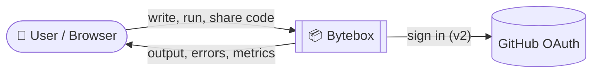
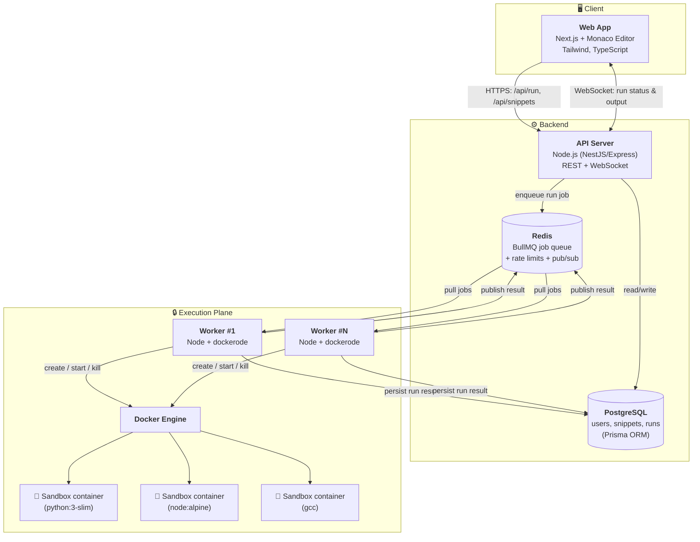
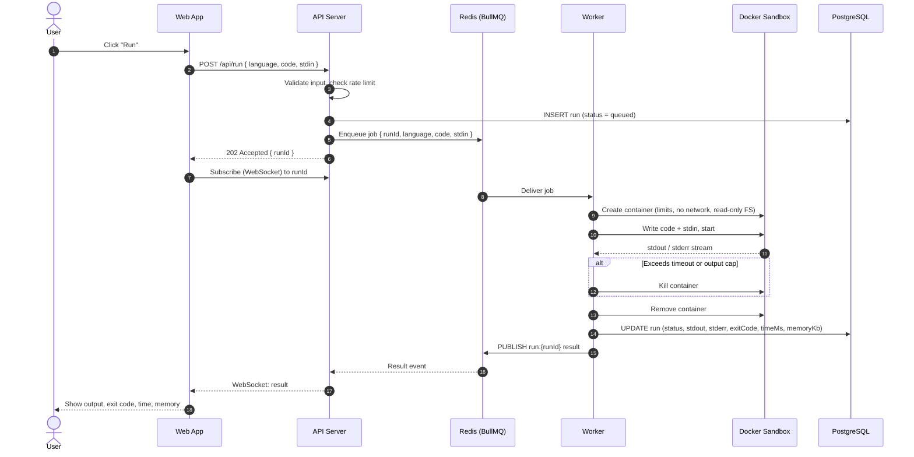
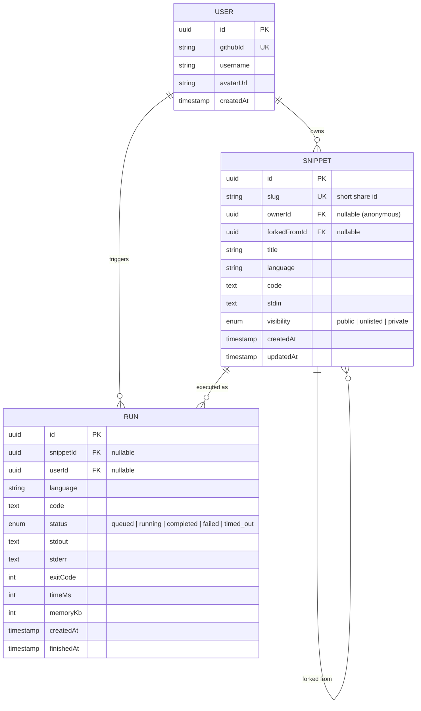

# Bytebox — Architecture Overview

> An online code playground: write code in the browser, run it in an isolated sandbox, get the output back, and share snippets via link.

**Status:** Draft (v0.1) · **Assumed stack:** TypeScript end-to-end (Next.js + Node), PostgreSQL, Redis, Docker

---

## 1. Goals & Non-Goals

**Goals**
- Run untrusted user code **safely** with strict CPU, memory, time, process and network limits.
- Feel fast: a typical run finishes in **< 2s** end to end.
- Share snippets with short, stable URLs (`/s/a8Kx2p`).
- Scale horizontally by adding more workers.

**Non-goals (for v1)**
- Full IDE features (multi-file projects, terminals, package installs).
- Persistent long-running processes or servers inside the sandbox.
- Network access from user code.

---

## 2. System Context



---

## 3. High-Level Architecture (Containers)



### Component responsibilities

| Component | Responsibility | Key tech |
|---|---|---|
| **Web App** | Editor UI, language picker, stdin, output panel, share/fork, auth UI | Next.js, React, Monaco, Tailwind |
| **API Server** | Validation, auth, rate limiting, snippet CRUD, enqueue runs, push results to clients | NestJS/Express, Zod, Socket.IO/ws |
| **Redis** | Job queue, pub/sub for results, rate-limit counters, short-lived caches | Redis 7, BullMQ |
| **PostgreSQL** | Durable storage for users, snippets, run history | Postgres 16, Prisma |
| **Worker** | Pulls jobs, prepares sandbox, runs code, enforces limits, collects output | Node, dockerode |
| **Sandbox** | Disposable, locked-down container per run, destroyed after execution | Docker (later: gVisor / Firecracker) |

---

## 4. Code Execution Flow



**Run states:** `queued → running → completed | failed | timed_out | killed`

---

## 5. Sandbox Security Model

Running untrusted code is the core risk of the system. Every run gets a **fresh, single-use container** with these defenses:

```mermaid
flowchart LR
    code["Untrusted user code"] --> L1

    subgraph Layers["Defense in depth"]
        direction TB
        L1["⏱️ Wall-clock timeout<br/>(e.g. 5s → SIGKILL)"]
        L2["🧠 Memory limit<br/>--memory=128m, no swap"]
        L3["🧮 CPU limit<br/>--cpus=0.5"]
        L4["🍴 Process limit<br/>--pids-limit=64"]
        L5["🌐 No network<br/>--network=none"]
        L6["📁 Read-only rootfs<br/>+ small tmpfs /tmp"]
        L7["👤 Non-root user<br/>--user=65534"]
        L8["🛡️ Drop all capabilities<br/>no-new-privileges, seccomp"]
        L9["📏 Output cap<br/>(e.g. 64 KB, truncated)"]
        L1 --> L2 --> L3 --> L4 --> L5 --> L6 --> L7 --> L8 --> L9
    end

    L9 --> result["Safe result returned"]
```



| Threat | Mitigation |
|---|---|
| Infinite loop | Wall-clock timeout + container kill |
| Memory bomb | `--memory`, `--memory-swap` equal to memory |
| Fork bomb | `--pids-limit` |
| CPU starvation of other users | `--cpus`, bounded worker concurrency |
| Network abuse / data exfiltration | `--network=none` |
| Tampering with host / image | Read-only rootfs, tmpfs, non-root, `--cap-drop=ALL` |
| Container escape | `no-new-privileges`, seccomp profile; later gVisor (`runsc`) or Firecracker microVMs |
| Output flooding | Stream with byte cap, truncate |
| API abuse / spam | Per-IP and per-user rate limits in Redis, max code size |

> ⚠️ Workers talk to the Docker socket, which is effectively **root on the host**. The worker host must be isolated from the API and DB hosts in production.

---

## 6. Supported Languages (initial)

Languages are defined in config, so new ones can be added without code changes.

| Language | Image | Run command |
|---|---|---|
| Python | `python:3.13-slim` | `python3 /code/main.py` |
| JavaScript | `node:22-alpine` | `node /code/main.js` |
| C++ | `gcc:14` | `g++ -O2 -o /tmp/a /code/main.cpp && /tmp/a` |

```ts
// Shape of a language definition
interface LanguageConfig {
  id: string;            // "python"
  image: string;         // "python:3.13-slim"
  fileName: string;      // "main.py"
  compile?: string[];    // optional compile step
  run: string[];         // run command
  timeoutMs: number;
  memoryMb: number;
}
```

---

## 7. Data Model



---

## 8. API Surface (v1)

| Method | Endpoint | Description |
|---|---|---|
| `GET` | `/api/languages` | List supported languages |
| `POST` | `/api/run` | Submit code for execution → `{ runId }` |
| `GET` | `/api/runs/:id` | Get run status/result (polling fallback) |
| `WS` | `/ws` → `subscribe:run` | Real-time run status & output |
| `POST` | `/api/snippets` | Create snippet → `{ slug }` |
| `GET` | `/api/snippets/:slug` | Get snippet |
| `PATCH` | `/api/snippets/:slug` | Update own snippet (auth) |
| `POST` | `/api/snippets/:slug/fork` | Fork a snippet |
| `GET` | `/api/me/snippets` | List my snippets (auth) |
| `GET` | `/api/auth/github` | OAuth login (v2) |

---

## 9. Repository Layout (monorepo)

```
bytebox/
├── apps/
│   ├── web/                # Next.js frontend
│   ├── api/                # REST + WebSocket server
│   └── worker/             # Job consumer + Docker sandbox runner
├── packages/
│   ├── shared/             # Shared types, Zod schemas, language configs
│   └── db/                 # Prisma schema, migrations, client
├── sandbox/
│   ├── images/             # Custom hardened Dockerfiles per language
│   └── seccomp.json        # Seccomp profile
├── infra/
│   └── docker-compose.yml  # Postgres, Redis, api, worker, web
├── ARCHITECTURE.md
└── README.md
```

Tooling: **pnpm workspaces** (or Turborepo), ESLint + Prettier, Vitest, GitHub Actions CI.

---

## 10. Deployment

```mermaid
flowchart TB
    internet((🌍 Internet)) --> cdn["CDN / Vercel<br/>(Next.js web)"]
    internet --> lb["Reverse proxy<br/>(Caddy / Nginx, TLS)"]

    subgraph AppHost["App host / VPS"]
        lb --> api1["API #1"]
        lb --> api2["API #2"]
        redis[("Redis")]
        pg[("PostgreSQL")]
        api1 & api2 --> redis
        api1 & api2 --> pg
    end

    subgraph ExecHost["Isolated execution host(s)"]
        w1["Worker"] --> dk["Docker Engine<br/>(+ gVisor runtime)"]
        w2["Worker"] --> dk
    end

    redis <--> w1 & w2
    w1 & w2 --> pg
    cdn -. "API calls" .-> lb
```



- **Local dev:** `docker compose up` runs Postgres, Redis, api, worker and web.
- **Production:** frontend on Vercel; API + data on a VPS or managed services; workers on **separate VM(s)** because they control Docker.
- **Scaling:** add API replicas behind the proxy; add worker VMs and raise worker concurrency.

---

## 11. Cross-Cutting Concerns

| Concern | Approach |
|---|---|
| **Validation** | Zod schemas shared between web, api and worker (`packages/shared`) |
| **Rate limiting** | Redis sliding window: per IP (anonymous) and per user |
| **Limits** | Max code size (e.g. 64 KB), max stdin, max output, per-language timeouts |
| **Observability** | Structured logs (pino), metrics (queue depth, run latency, timeouts), health checks |
| **Warm start** | Pre-pull images at worker boot; later keep a small pool of pre-created containers |
| **Cleanup** | Always remove containers in `finally`; periodic reaper for orphaned containers |
| **Config** | Env vars validated at startup; no secrets in sandbox environment |
| **Testing** | Unit tests for runner limits (infinite loop, fork bomb, memory bomb), integration tests via compose |

---

## 12. Development Plan (Step by Step)

Each step ends with something runnable. Tick boxes as features land.

### Step 0 — Project Setup & Tooling
- [ ] Monorepo foundation
  - [ ] Initialize pnpm workspaces (`apps/*`, `packages/*`)
  - [ ] Root `package.json` with shared scripts (`dev`, `build`, `lint`, `test`, `typecheck`)
  - [ ] Base `tsconfig.json` with strict mode, extended by each app/package
- [ ] Code quality
  - [ ] ESLint + Prettier config
  - [ ] Husky + lint-staged pre-commit hook
  - [ ] Vitest set up at the root
- [ ] Repo hygiene
  - [ ] `.gitignore`, `.editorconfig`, `.nvmrc`
  - [ ] `README.md` with project intro and how to run
  - [ ] `.env.example` files
- [ ] Local infrastructure
  - [ ] `infra/docker-compose.yml` with PostgreSQL + Redis
  - [ ] Verify both services start and are reachable

**✅ Done when:** `pnpm install && pnpm lint && docker compose up` all succeed.

---

### Step 1 — Sandbox Runner (the core)
- [ ] Shared package (`packages/shared`)
  - [ ] `LanguageConfig` type and configs for Python, JavaScript, C++
  - [ ] `RunRequest` / `RunResult` types + Zod schemas
- [ ] Runner module (`apps/worker/src/runner`)
  - [ ] Connect to Docker via `dockerode`
  - [ ] Pre-pull language images on startup
  - [ ] Write code + stdin into the container (tar archive or tmpfs)
  - [ ] Optional compile step (C++), then run step
  - [ ] Capture stdout / stderr separately
  - [ ] Return exit code, execution time and memory usage
- [ ] Resource limits
  - [ ] Wall-clock timeout → kill container
  - [ ] Memory limit (no swap)
  - [ ] CPU limit
  - [ ] PID limit
  - [ ] Output size cap with truncation flag
- [ ] Isolation
  - [ ] `--network=none`
  - [ ] Read-only root filesystem + small tmpfs `/tmp`
  - [ ] Non-root user
  - [ ] `--cap-drop=ALL`, `no-new-privileges`
- [ ] Cleanup
  - [ ] Always remove the container in `finally`
  - [ ] Label containers (`bytebox=sandbox`) so orphans can be found
- [ ] CLI for manual testing: `pnpm runner ./examples/hello.py`
- [ ] Tests
  - [ ] Hello world for each language
  - [ ] Infinite loop → `timed_out`
  - [ ] Memory bomb → killed
  - [ ] Fork bomb → contained
  - [ ] Network call → fails
  - [ ] Huge output → truncated
  - [ ] Compile error (C++) → reported in stderr

**✅ Done when:** all abuse tests pass and nothing escapes the limits.

---

### Step 2 — Database Layer
- [ ] `packages/db` with Prisma
  - [ ] `User`, `Snippet`, `Run` models (see Data Model)
  - [ ] Enums: `RunStatus`, `Visibility`
  - [ ] Indexes on `Snippet.slug`, `Run.userId`, `Run.createdAt`
  - [ ] First migration
  - [ ] Seed script with example snippets
- [ ] Export a shared Prisma client for api + worker

**✅ Done when:** `pnpm db:migrate && pnpm db:seed` works against local Postgres.

---

### Step 3 — API Server + Job Queue
- [ ] API app skeleton (`apps/api`)
  - [ ] HTTP server (NestJS or Express) with TypeScript
  - [ ] Env config validated with Zod at startup
  - [ ] Structured logging (pino)
  - [ ] Global error handler + consistent error format
  - [ ] CORS for the web app
  - [ ] `GET /health` endpoint
- [ ] Queue
  - [ ] BullMQ `runs` queue on Redis
  - [ ] Job payload: `{ runId, language, code, stdin }`
  - [ ] Retry policy (no retries for user errors, retry on infra errors)
- [ ] Endpoints
  - [ ] `GET /api/languages`
  - [ ] `POST /api/run` → validate, create `Run (queued)`, enqueue, return `{ runId }`
  - [ ] `GET /api/runs/:id` → status + result (polling)
- [ ] Input limits
  - [ ] Max code size (e.g. 64 KB)
  - [ ] Max stdin size
  - [ ] Unknown language → 400
- [ ] Worker app (`apps/worker`)
  - [ ] BullMQ consumer with configurable concurrency
  - [ ] Mark run `running` → execute via runner → save result
  - [ ] Graceful shutdown (finish current jobs, then exit)
- [ ] Integration tests: submit → poll → result

**✅ Done when:** `curl -X POST /api/run` returns a runId and polling returns the output.

---

### Step 4 — Frontend: Editor & Run
- [ ] Web app skeleton (`apps/web`)
  - [ ] Next.js (App Router) + TypeScript + Tailwind
  - [ ] Layout: header, editor area, output panel
  - [ ] Dark / light theme
- [ ] Editor
  - [ ] Monaco Editor integration
  - [ ] Language picker (loaded from `/api/languages`)
  - [ ] Starter template per language
  - [ ] Keyboard shortcut: `Ctrl/Cmd + Enter` to run
- [ ] Run experience
  - [ ] Stdin input panel
  - [ ] Run button with loading state
  - [ ] Poll for results
  - [ ] Output panel: stdout, stderr (colored), exit code, time, memory
  - [ ] Clear states for `timed_out`, `failed`, truncated output
- [ ] Resilience
  - [ ] Error toasts for network / API errors
  - [ ] Autosave current code to localStorage
- [ ] Responsive layout (editor and output stack on mobile)

**✅ Done when:** a user can write code, run it and see the result in the browser.

---

### Step 5 — Snippets & Sharing
- [ ] Backend
  - [ ] `POST /api/snippets` → create snippet with short slug (nanoid)
  - [ ] `GET /api/snippets/:slug`
  - [ ] `POST /api/snippets/:slug/fork`
  - [ ] Visibility: `public`, `unlisted`
- [ ] Frontend
  - [ ] "Share" button → save + copy link to clipboard
  - [ ] `/s/[slug]` page loads snippet into the editor
  - [ ] "Fork" button on shared snippets
  - [ ] Snippet title editing
  - [ ] Open Graph meta tags for nice link previews

**✅ Done when:** a shared link opens the same code for another person, who can run and fork it.

---

### Step 6 — Real-Time Output (WebSocket)
- [ ] Backend
  - [ ] WebSocket server (Socket.IO or `ws`) on the API
  - [ ] Worker publishes status + output chunks to Redis pub/sub
  - [ ] API relays events to subscribed clients by `runId`
  - [ ] Events: `run:status`, `run:output`, `run:done`
- [ ] Worker
  - [ ] Stream container stdout/stderr in chunks instead of waiting for exit
- [ ] Frontend
  - [ ] Subscribe on run, render output line by line
  - [ ] Fall back to polling if the WebSocket fails
  - [ ] "Stop" button to cancel a running job

**✅ Done when:** output appears live while a program is still running.

---

### Step 7 — Authentication & User Features
- [ ] Auth
  - [ ] GitHub OAuth login
  - [ ] Session cookies (httpOnly, secure) or JWT
  - [ ] `GET /api/me`, logout
  - [ ] Auth guard / middleware for protected routes
- [ ] User features
  - [ ] Link snippets and runs to the logged-in user
  - [ ] `GET /api/me/snippets` → "My Snippets" dashboard
  - [ ] Edit / delete own snippets
  - [ ] `private` visibility for logged-in users
  - [ ] Run history page
- [ ] Frontend
  - [ ] Login button + user menu with avatar
  - [ ] Dashboard page with search and filter by language

**✅ Done when:** users can sign in, and their snippets persist across devices.

---

### Step 8 — Abuse Protection & Limits
- [ ] Rate limiting (Redis)
  - [ ] Per-IP limit for anonymous users
  - [ ] Higher per-user limit for logged-in users
  - [ ] `429` responses with `Retry-After`
- [ ] Queue protection
  - [ ] Max queue depth → reject new runs when overloaded
  - [ ] Per-user concurrent-run limit
- [ ] Security headers (helmet), request size limits
- [ ] Orphan container reaper (cron job in worker)

**✅ Done when:** spamming the Run button can't take the system down.

---

### Step 9 — Sandbox Hardening
- [ ] Custom minimal Dockerfiles per language (`sandbox/images`)
- [ ] Custom seccomp profile (`sandbox/seccomp.json`)
- [ ] gVisor (`runsc`) runtime for stronger isolation
- [ ] Warm container pool to cut cold-start latency
- [ ] Add more languages (Go, Java, Rust, TypeScript)
- [ ] Security test suite: known escape attempts, `/proc` probing, env var leaks

**✅ Done when:** p95 run latency is under 2s and hardening tests pass.

---

### Step 10 — Observability, CI/CD & Deployment
- [ ] Observability
  - [ ] Metrics: queue depth, run latency, timeouts, error rate
  - [ ] Health + readiness checks for every service
  - [ ] Basic admin / stats page
- [ ] CI (GitHub Actions)
  - [ ] Lint, typecheck, unit tests on every PR
  - [ ] Integration tests with Docker services
  - [ ] Build Docker images for api and worker
- [ ] Deployment
  - [ ] Production Dockerfiles for api + worker
  - [ ] Frontend on Vercel
  - [ ] API, Postgres, Redis on a VPS (or managed services)
  - [ ] Workers on a **separate** VM
  - [ ] Reverse proxy with TLS (Caddy)
  - [ ] Database backups
- [ ] Docs
  - [ ] README with screenshots and setup guide
  - [ ] API documentation

**✅ Done when:** Bytebox is live on a public URL.

---

### Step 11 — Stretch Goals
- [ ] Multi-file projects with a file tree
- [ ] HTML/CSS/JS live preview (runs in a browser iframe, not on the server)
- [ ] Collaborative editing (Yjs + live cursors)
- [ ] Challenge mode: problems with hidden test cases and a leaderboard
- [ ] AI assistant: "explain this error", "fix my code"
- [ ] Embeddable snippets (`<iframe>` widget for blogs)
- [ ] Snippet likes, comments and a public explore page

---

## 13. Key Decisions (to confirm)

| Decision | Choice | Rationale |
|---|---|---|
| Language | TypeScript everywhere | One language, shared types across web/api/worker |
| Execution isolation | Docker per run (v1) → gVisor (v2) | Simple to start, upgrade path to stronger isolation |
| Async model | Queue + workers | Absorbs bursts, isolates execution plane, scales horizontally |
| Result delivery | WebSocket with polling fallback | Real-time UX, resilient |
| Database | PostgreSQL + Prisma | Relational data, typed client, easy migrations |
