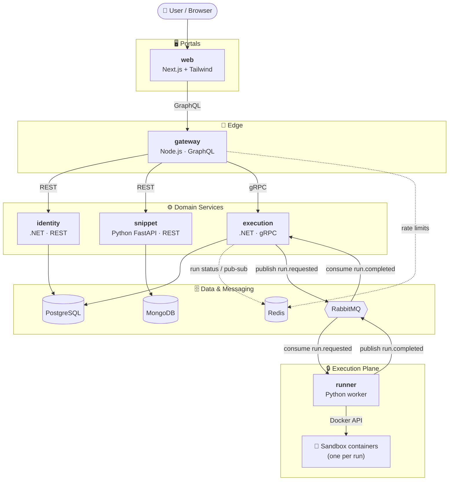
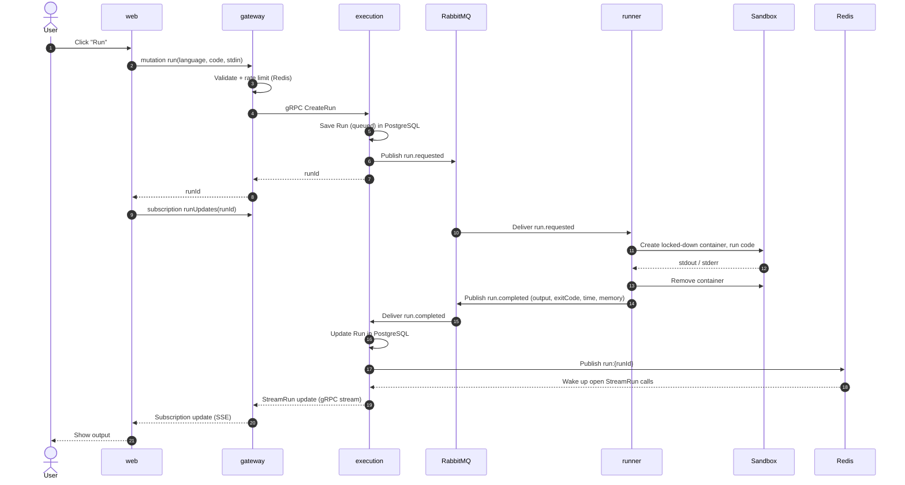
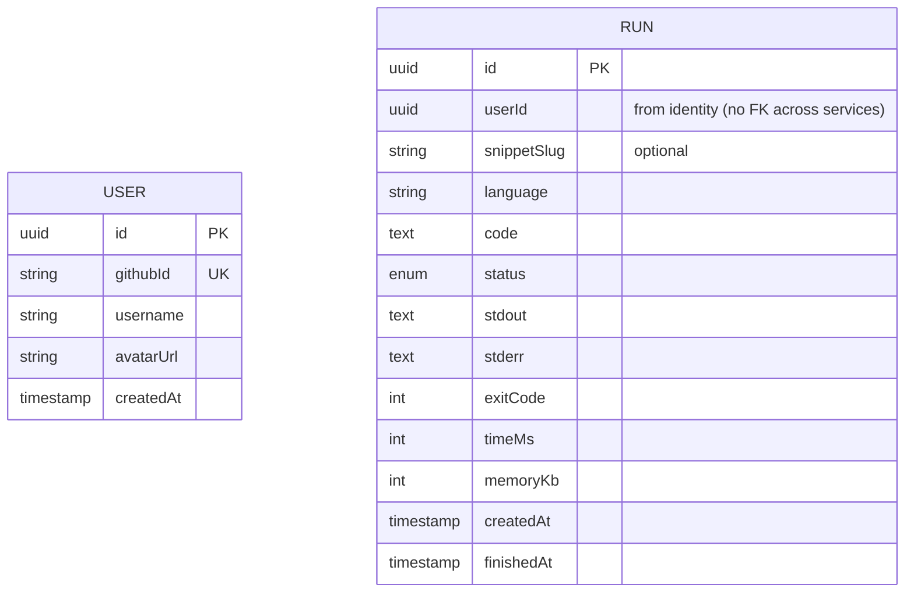
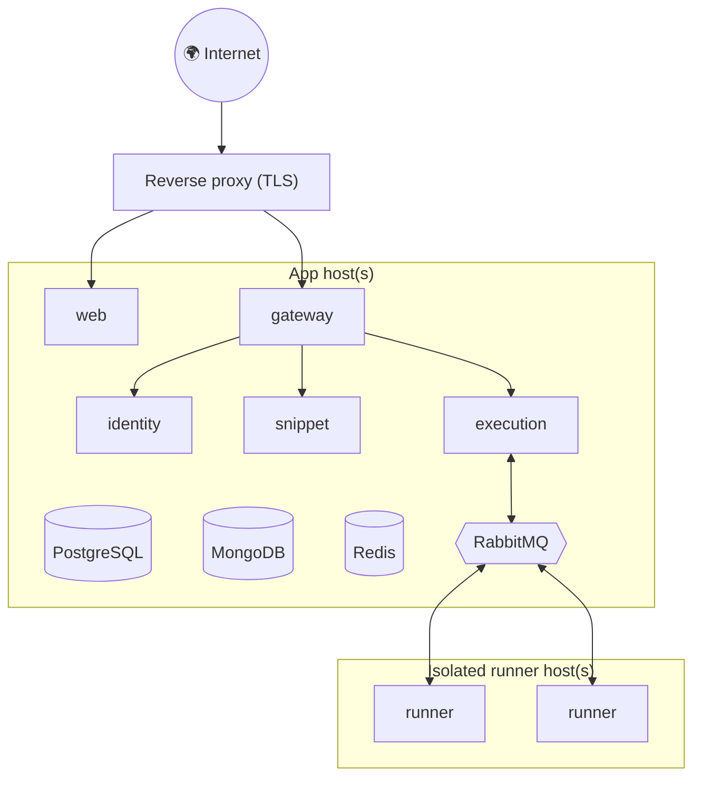

# Bytebox — Architecture Overview

> An online code playground: write code in the browser, run it in an isolated sandbox, get the output back, and share snippets via link.

**Status:** Draft (v0.2) · **Style:** Microservices, one folder + one Dockerfile per domain, everything orchestrated with `docker-compose.yml`

---

## 1. Goals & Non-Goals

**Goals**
- Run untrusted user code **safely** with strict CPU, memory, time, process and network limits.
- Feel fast: a typical run finishes in **< 2s** end to end.
- Share snippets with short, stable URLs (`/s/a8Kx2p`).
- Each domain is an independent service that can be built, deployed and scaled on its own.

**Non-goals (for v1)**
- Full IDE features (multi-file projects, terminals, package installs).
- Persistent long-running processes or servers inside the sandbox.
- Network access from user code.

---

## 2. Services at a Glance

| Folder | Domain | Tech | Exposes | Owns data in | Host port |
|---|---|---|---|---|---|
| `portals/web` | Web portal (UI) | Next.js, TypeScript, Tailwind CSS | Web pages | – | 3000 |
| `services/gateway` | API gateway / BFF | Node.js, TypeScript, GraphQL Yoga | **GraphQL** | Redis (rate limits) | 4000 |
| `services/identity` | Users & auth | .NET (ASP.NET Core) | **REST** | PostgreSQL `identity` | 5001 |
| `services/execution` | Run lifecycle | .NET (ASP.NET Core) | **gRPC** (+ REST health) | PostgreSQL `execution`, Redis | 5002 |
| `services/snippet` | Snippets & sharing | Python, FastAPI | **REST** | MongoDB | 5003 |
| `services/runner` | Sandbox worker | Python | **RabbitMQ** consumer | – | – |

**Infrastructure**

| Component | Purpose | Host port |
|---|---|---|
| PostgreSQL 16 | Relational data (users, runs) — one database per service | 5432 |
| MongoDB 8 | Document data (snippets) | 27017 |
| Redis 7 | Cache, rate limits, run status, pub/sub | 6380 |
| RabbitMQ 4 | Event bus between execution and runner | 5673 (UI: 15673) |

> Host ports for Redis and RabbitMQ are shifted (6380, 5673) so they don't clash with local instances. Inside the Docker network every service uses the default ports.

---

## 3. High-Level Architecture



### Communication styles

| From → To | Style | Why |
|---|---|---|
| web → gateway | **GraphQL** (HTTP, subscriptions over Server-Sent Events) | One flexible API for the UI, live run updates via subscriptions |
| gateway → identity, snippet | **REST** | Simple CRUD resources |
| gateway → execution | **gRPC** | Typed contract, fast internal calls, streaming output |
| execution ↔ runner | **RabbitMQ events** | Decouples API from slow, risky execution; absorbs bursts; scale runners independently |
| execution → gateway (live updates) | **gRPC server streaming** (`StreamRun`) | Gateway turns the stream into a GraphQL subscription |
| inside execution | **Redis pub/sub** (`run:{id}`) | Wakes up open `StreamRun` calls when a result is saved |

---

## 4. Code Execution Flow



**Run states:** `queued → running → completed | timed_out | memory_exceeded | failed`

- `completed`: the program finished (any exit code, including compile errors)
- `timed_out`: killed after the time limit
- `memory_exceeded`: killed for using too much memory
- `failed`: Bytebox could not run it (unknown language, code too large, internal error)

### Events (RabbitMQ)

| Event | Producer | Consumer | Payload |
|---|---|---|---|
| `run.requested` | execution | runner | `runId, language, code, stdin, limits` |
| `run.started` | runner | execution | `runId, startedAt` |
| `run.completed` | runner | execution | `runId, status, exitCode, stdout, stderr, truncated, timeMs` |

---

## 5. Sandbox Security Model

Running untrusted code is the core risk. Every run gets a **fresh, single-use container**:

| Threat | Mitigation |
|---|---|
| Infinite loop | Wall-clock timeout + container kill |
| Memory bomb | `--memory`, no swap |
| Fork bomb | `--pids-limit` |
| CPU starvation | `--cpus`, bounded runner concurrency |
| Network abuse | `--network=none` |
| Tampering with host | Read-only rootfs, tmpfs `/tmp`, non-root user, `--cap-drop=ALL` |
| Container escape | `no-new-privileges`, seccomp; later gVisor or Firecracker |
| Output flooding | Byte cap + truncation |
| API abuse | Rate limits in gateway (Redis), max code size |

> ⚠️ The runner talks to the Docker socket, which is effectively **root on the host**. In production, runners live on separate, isolated machines.

---

## 6. Data Ownership

Each service owns its data. No service reads another service's database.



- **identity → PostgreSQL `identity`:** `users`
- **execution → PostgreSQL `execution`:** `runs`
- **snippet → MongoDB `snippets` collection:**

```json
{
  "_id": "ObjectId",
  "slug": "a8Kx2p",
  "ownerId": "uuid | null",
  "forkedFrom": "slug | null",
  "title": "Hello world",
  "language": "python",
  "code": "print('hi')",
  "stdin": "",
  "visibility": "public | unlisted | private",
  "createdAt": "date",
  "updatedAt": "date"
}
```

---

## 7. Repository Layout

```
bytebox/
├── docker-compose.yml        # Runs infrastructure + all services + portals
├── .env.example
├── infra/
│   └── postgres/init.sql     # Creates one database per service
├── proto/                    # Shared gRPC contracts (execution.proto)
├── portals/
│   └── web/                  # Next.js + Tailwind      → Dockerfile
└── services/
    ├── gateway/              # Node.js GraphQL gateway → Dockerfile
    ├── identity/             # .NET REST service       → Dockerfile
    ├── execution/            # .NET gRPC service       → Dockerfile
    ├── snippet/              # Python FastAPI service  → Dockerfile
    └── runner/               # Python sandbox worker   → Dockerfile
```

### Running locally

```bash
docker compose up -d --build     # build and start everything
docker compose ps                # see what's running
docker compose logs -f runner    # follow one service's logs
docker compose down              # stop everything
```

| URL | What |
|---|---|
| http://localhost:3000 | Web portal |
| http://localhost:4000/graphql | GraphQL API (GraphiQL in browser) |
| http://localhost:5001/health | identity |
| http://localhost:5002/health | execution (REST) |
| localhost:50051 | execution (gRPC) |
| http://localhost:5003/docs | snippet (Swagger UI) |
| http://localhost:15673 | RabbitMQ management UI |

---

## 8. Deployment (later)



- Same images as local; compose for a single VM first, Kubernetes later if needed.
- Runners on **separate machines** because they control Docker.
- Scale by adding runner replicas (`docker compose up --scale runner=3`).

---

## 9. Development Plan (Step by Step)

Each step ends with something runnable via `docker compose up`. Every step is a `feature/*` branch + PR.

### Step 0 — Project Skeleton
- [x] Folder per domain (`portals/*`, `services/*`)
- [x] Dockerfile for every service
- [x] `docker-compose.yml` with PostgreSQL, MongoDB, Redis, RabbitMQ + all services
- [x] `/health` endpoint in every HTTP service
- [x] Runner connects to RabbitMQ and listens on `run.requested`
- [x] Web portal landing page (Next.js + Tailwind)
- [x] `.gitignore`, `.editorconfig`, `.env.example`
- [x] Verify the .NET services build and answer `/health`

**✅ Done when:** `docker compose up -d --build` starts everything and all health checks pass.

### Step 1 — Runner: Sandboxed Execution
- [x] Language configs (Python, JavaScript, C++ with a small Alpine + g++ image)
- [x] Run code in a fresh Docker container (Docker socket mounted into runner)
- [x] Limits: timeout, memory, CPU, PIDs, output cap (64 KB), code size (64 KB)
- [x] Isolation: no network, read-only FS, non-root, drop capabilities, no-new-privileges
- [x] Always remove containers; label them `bytebox=sandbox`
- [x] Consume `run.requested`, publish `run.completed` with output, exit code and time
- [x] Tests: hello world per language, compile/runtime errors, infinite loop, fork bomb, memory bomb, network call, read-only FS, non-root, huge output, output flood
- [x] `send_job.py` script to try the runner by hand
- [ ] Memory usage metric per run (later)

**Try it:**

```bash
cd services/runner
python3 -m venv .venv && .venv/bin/pip install -r requirements-dev.txt
.venv/bin/python -m pytest                                   # sandbox tests
.venv/bin/python send_job.py python examples/hello.py Vedat  # full round trip via RabbitMQ
```

### Step 2 — Execution Service
- [x] `proto/execution.proto` (`CreateRun`, `GetRun`, `StreamRun`)
- [x] gRPC server in .NET on port 8081 (HTTP/2), `/health` on 8080, gRPC reflection enabled
- [x] `runs` table in PostgreSQL (EF Core, created on startup; switch to migrations when the schema changes)
- [x] Validate language and code size, publish `run.requested`
- [x] Consume `run.completed`, save the result, publish the update on Redis channel `run:{runId}`
- [x] `StreamRun` sends the current state, then updates until the run is finished

**Try it** (uses the `grpcurl` Docker image, nothing to install):

```bash
# Create a run
docker run --rm --network bytebox_default fullstorydev/grpcurl -plaintext \
  -d '{"language":"python","code":"print(input()[::-1])","stdin":"bytebox"}' \
  execution:8081 bytebox.execution.v1.ExecutionService/CreateRun

# Get the result (use the run_id from above)
docker run --rm --network bytebox_default fullstorydev/grpcurl -plaintext \
  -d '{"run_id":"<RUN_ID>"}' \
  execution:8081 bytebox.execution.v1.ExecutionService/GetRun
```

### Step 3 — Gateway (GraphQL)
- [x] Schema: `languages`, `run(id)` query, `createRun` mutation, `RunStatus` enum
- [x] gRPC client to execution (proto loaded at runtime from `proto/`)
- [x] `runUpdates(id)` subscription fed by execution's `StreamRun` (Server-Sent Events)
- [x] Input validation: supported language, max code size (64 KB)
- [x] Rate limiting with Redis: 20 runs per minute per IP (`RATE_LIMIT_RUNS_PER_MINUTE`)
- [x] Error codes for the UI: `BAD_USER_INPUT`, `NOT_FOUND`, `RATE_LIMITED`, `SERVICE_UNAVAILABLE`

**Try it:** open http://localhost:4000/graphql (GraphiQL) and run:

```graphql
mutation {
  createRun(input: { language: "python", code: "print(input().upper())", stdin: "hi" }) {
    id
    status
  }
}

subscription {
  runUpdates(id: "<RUN_ID>") { status stdout stderr exitCode timeMs }
}
```

### Step 4 — Web Portal: Editor & Run
- [x] Small GraphQL client: `fetch` for queries/mutations, `EventSource` for subscriptions (no library needed)
- [x] Monaco editor + language picker (loaded from `languages`) + starter template per language
- [x] Stdin panel, Run button, `⌘/Ctrl + Enter`
- [x] Output panel: stdout, stderr (red), exit code, time, status badge, truncation note
- [x] Live status via `runUpdates` subscription
- [x] Friendly errors: rate limited, API unreachable, invalid input
- [x] Autosave language, code (per language) and stdin in `localStorage`
- [x] Responsive: editor and output side by side on desktop, stacked on mobile

> The browser calls the gateway directly at `NEXT_PUBLIC_GATEWAY_URL` (default `http://localhost:4000/graphql`). It is set as a Docker build argument because Next.js inlines it at build time.

### Step 5 — Snippet Service & Sharing
- [ ] MongoDB connection + `snippets` collection with unique `slug` index
- [ ] REST: create, get by slug, fork, update, delete
- [ ] Gateway: snippet queries and mutations
- [ ] Web: Share button, `/s/[slug]` page, Fork button

### Step 6 — Identity Service & Auth
- [ ] `users` table (EF Core)
- [ ] GitHub OAuth login
- [ ] Issue JWT; gateway validates it and passes user id downstream
- [ ] Web: login, user menu, "My Snippets" dashboard, run history

### Step 7 — Abuse Protection & Hardening
- [ ] Per-IP and per-user rate limits
- [ ] Max concurrent runs per user, reject when queue is too deep
- [ ] Orphan container reaper in runner
- [ ] Custom seccomp profile, gVisor runtime
- [ ] More languages (Go, Java, Rust, TypeScript)

### Step 8 — Observability, CI/CD & Deployment
- [ ] Structured logs in every service, health/readiness checks
- [ ] Metrics: queue depth, run latency, timeouts, error rate
- [ ] GitHub Actions: build + test each service, build Docker images
- [ ] Deploy with compose on a VM, runners on a separate VM, TLS proxy

### Step 9 — Stretch Goals
- [ ] Multi-file projects
- [ ] HTML/CSS/JS live preview (browser iframe)
- [ ] Collaborative editing (Yjs)
- [ ] Challenge mode with hidden test cases + leaderboard
- [ ] AI "explain this error"
- [ ] Admin portal (`portals/admin`) for stats and moderation

---

## 10. Key Decisions

| Decision | Choice | Rationale |
|---|---|---|
| Architecture | Microservices, one folder + Dockerfile per domain | Independent build/deploy/scale per domain, polyglot learning |
| Orchestration | Docker Compose | One command to run everything locally |
| UI → backend | GraphQL via gateway | Single entry point, flexible queries, subscriptions for live output |
| Internal sync calls | REST (CRUD), gRPC (execution) | REST for simple resources, gRPC for typed fast calls + streaming |
| Async | RabbitMQ | Simple, reliable work queue; Kafka not needed at this scale |
| Data | PostgreSQL (users, runs), MongoDB (snippets), Redis (cache/pub-sub) | Right store per data shape; each service owns its data |
| Isolation | Docker per run → gVisor later | Simple start, clear upgrade path |
